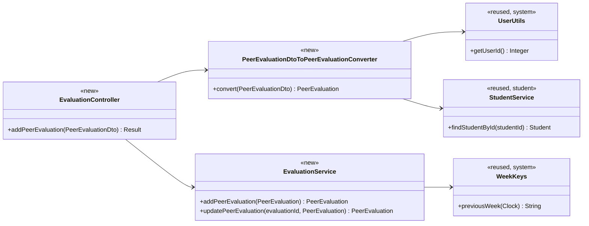
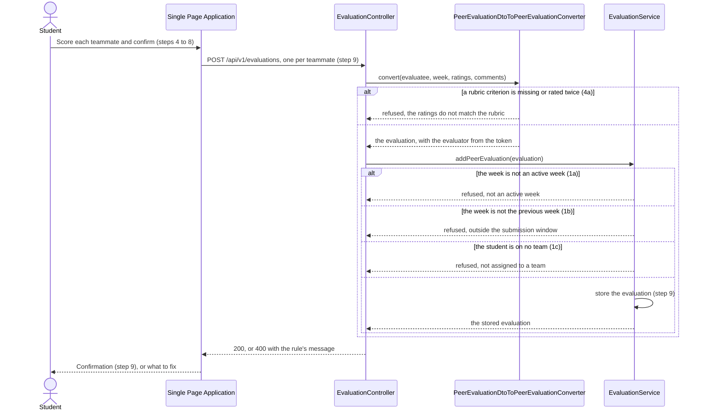

# _[Area name]_ Design

**Project:** _[Your project name]_
**Team:** _[Team NN]_
**Area:** _[`UC-<AREA>`, for example `EVA`]_

> **Realizes:** _[every `UC-<AREA>-<slug>` and `FR-<AREA>-<slug>` this document designs, appended as each is designed]_
> **Depends on:** _[the business rules, constraints, and cross-cutting `FR-*` it builds on, by identifier]_
> **See:** _[links to the use cases, the specification, and your [architecture-of-record](architectural-design.md)]_
> **Designed against:** _[the commit of `main` you read the code at, for example `a1b2c3d`]_

---

_**How to use this template.** Copy it to `docs/design/<area>.md`, named for the lowercase area code (`eva.md` for `UC-EVA-*`). Instructions appear in italic square brackets; leave them in place until the document is stable, because the agent reads them on every later pass. The full worked example is Project Pulse's [`not.md`](https://github.com/Washingtonwei/project-pulse/blob/main/docs/design/not.md); read it for the shape, not for the answers._

_**What this document is.** The **design-of-record** for one use case area: how the code will realize its use cases, written **before** the code and approved before anyone builds from it. It is the last document your agent reads before it writes code, so anything it leaves out, the agent invents. Your [architecture-of-record](architectural-design.md) is the map of the whole system and stops at each component's responsibility; this document goes one level down, inside one area, against real code._

_**What it is not.** A copy of your use cases. It **cites** `UC-*`, `FR-*`, and `BR-*` by identifier and never restates what the system shall do; it says only how. It is also not a transcript of the code. Once code exists, link to the files rather than describing every class, column, or getter._

_**One document per area, not per use case.** Your area gains use cases over the term. The overview, the class diagram, and the data model are **revised in place** when it does. The sequence diagrams, the API contract rows, and the test rows are **appended**, one set per use case. Never add a `## UC-…` section that repeats the whole skeleton._

_**How much to write.** Pin down what a wrong guess would break: a requirement, a business rule, a quality attribute, or the contract between two parts of your team. Leave the rest for the agent to derive while it builds: variable names, field types, exact JSON, column lengths. When you are unsure, ask which side of that line a detail falls on, not whether it is interesting._

_**Write it in this order.** Each step is one person's or one pair's work, and the order is the point:_

1. _**Sketch it yourselves first.** Before you open the agent, draw the main success scenario's sequence diagram and write the API contract rows by hand, from the use case and your architecture-of-record. Twenty minutes, on paper or in this file._
2. _**Have the agent draft it.** Give the agent this template, the use case, the business rules it cites, your architecture-of-record's section 8 (Crosscutting Concepts), and the relevant existing code, and ask for a draft of this document. Use plan mode, so it proposes before it writes._
3. _**Compare the two.** Where the agent's draft differs from your sketch, decide which is right and why. What it found that you missed goes in; what you knew that it could not have known is the context your specification is missing, so fix the specification too._
4. _**Run the questions test** (the last section) and fix what it finds._
5. _**Open a pull request.** A teammate who did not write it reviews and approves it. Nobody starts an implementation branch from this design until it is merged._

---

## Overview

_[One paragraph: what this area does, which components of your [architecture-of-record](architectural-design.md) it lives in, and what it reads from or calls in other areas. Link the container diagram rather than redrawing it. If this design changes the architecture-of-record, say so here and list the change under "Changes to the architecture-of-record" below._

_Example, from Project Pulse's peer evaluation area, written as it would have read before its code existed:_

_Peer Evaluation takes a student's scores and comments for each teammate, herself included, for the previous week, and keeps them editable until that week's submission window closes. It is the `EVA` area of the REST API Application ([containers](architectural-design.md#51-containers), [use case areas](architectural-design.md#52-use-case-areas-and-components)), reads the rubric and the active weeks from the student's course section, and calls no external system.]_

## Components & classes

_[One class diagram for the whole area, and one line per class or file saying what it does and whether it is **new** or **reused**. Show only what a reader needs to see how the parts relate: classes, their key methods, their dependencies. Fields and getters belong to the code._

_**If your repository has no code for this area yet**, which is the normal case for your proving slice, list the files you expect the agent to create, with the paths your architecture-of-record's conventions give them, and mark them all new. The agent then builds into the structure you chose rather than one it improvised._

_Example:_]

- _`evaluation/EvaluationController` (new): the HTTP entry point; checks the request shape and nothing else._
- _`evaluation/converter/PeerEvaluationDtoToPeerEvaluationConverter` (new): takes the evaluator from the signed-in user, loads the evaluator and the evaluatee through `StudentService` (never its repository), and checks that every criterion of the evaluator's course section rubric is rated exactly once._
- _`evaluation/EvaluationService` (new): checks the submission window, the team, and duplicates, then stores the evaluation. An edit runs the same window check._
- _`system/UserUtils` and `system/WeekKeys` (reused): who is calling, and which week is the previous one by the injected clock._

## Sequence

_[One sequence diagram per use case for its main success scenario, plus one for each extension that does not just return an error. **Label each interaction with the use case step it implements**, so a reviewer can check that every step is realized and nothing extra was invented. Use `alt` blocks for extensions that branch off the main flow. Give each use case its own `###` heading; that heading is the anchor your traceability matrix cites._

_Example:]_

### _UC-EVA-submit-evaluation: submitting a peer evaluation_

## API contract

_[One row per endpoint, scheduled job, or message this area adds or changes, appended per use case. **This section is never dropped**: before the code exists it is the only thing the person (or agent session) building the front end and the one building the back end both read. Name the caller and who may call it, the request fields, the success response, and the error each extension returns. Leave field types and exact JSON to the agent unless a wrong guess would break something, such as a format another system depends on. Use the error shape your architecture-of-record's section 8.2 fixes; do not invent one here._

_Example:]_

| Endpoint or job | Caller (who may) | Request | Success | Errors, by extension |
|---|---|---|---|---|
| _`POST /api/v1/evaluations`_ | _A signed-in student, for herself only; the evaluator comes from the token, never the body_ | _Evaluatee id, week, a score for each rubric criterion, public comment, private comment_ | _`200`: the stored evaluation_ | _1a, 1b, 1c, 4a: `400 INVALID_ARGUMENT` with the rule's message. A teammate already evaluated that week, an evaluatee on another team, or a caller who is not a student: `400 INVALID_ARGUMENT`. An evaluatee id that names no student: `404`. Not signed in: `401`._ |
| _`PUT /api/v1/evaluations/{evaluationId}`_ | _The student who submitted it, while its window is open (step 7)_ | _The same fields as the `POST`. Only the scores and comments change; the stored week wins over the one sent_ | _`200`: the updated evaluation_ | _Window closed (1b): `400 INVALID_ARGUMENT`. Another student's evaluation: `403`, refused by the route rule, which lets only the evaluation's evaluator edit it._ |

## Key decisions

_[Only the decisions a reader could not recover from the code: an invariant, who may do this and how it is enforced, a trade-off you chose, a reason you reused something rather than writing it. **Each one names what you chose, what you rejected, and why.** If you cannot name an alternative you considered, it probably was not a decision; leave it out._

_A decision that affects the whole system rather than this area is an architecture decision. It belongs in your architecture-of-record as a `KD-*` entry, not here._

_Example:]_

**_Where the evaluator comes from._** _From the signed-in user's token, read through `UserUtils`, never from the request body (architecture-of-record 8.1, authorization). Rejected: an evaluator id in the body, because any student could then submit an evaluation in a teammate's name._

**_How the window closes._** _On the server, against the injected clock, on every submit and every edit: an evaluation is editable exactly while its week is still the previous week (`BR-evaluation-submission-window`, `BR-evaluation-editable-until-close`, architecture-of-record 8.2, time). Rejected: a "final" flag that a scheduled job sets when the week rolls over, because the clock already says when the window closed, and a flag could disagree with it._

## Data model

_[The **change** this area makes to the data: new tables or entities, new columns, the migration that adds them. Draw an ER diagram when there is more than one new table. Do not redraw the domain model; your [specification](../requirements/software-requirements-specification.md) owns it, so link it and show only the change. If the area changes nothing, say "No change" and give the reason in one line; that is a design decision too.]_

## Reuse & cross-cutting

_[Which existing services, components, and conventions this area uses rather than rebuilding: authentication, the error handler, email, the clock, another area's service. Cite your architecture-of-record's section 8.2 for each convention by name rather than restating it.]_

## Tests

_[One row per flow: the main success scenario and **every** extension of every use case this document realizes, appended per use case. Name the level (unit or integration) and what the test asserts. No code. This list is the definition of done that the reviewer approves; the agent writes these tests when it builds, and a reviewer can see at a glance whether an extension has no test._

_Example:]_

| Use case, flow | Level | Asserts |
|---|---|---|
| _UC-EVA-submit-evaluation main_ | _integration_ | _A student on a team evaluates a teammate for the previous week; the evaluation is stored, and its total score is the sum of its ratings_ |
| _UC-EVA-submit-evaluation 1a_ | _unit_ | _With the injected clock in the course section's first active week, the evaluation is refused and nothing is stored_ |
| _UC-EVA-submit-evaluation 1b_ | _unit_ | _An evaluation for two weeks ago is refused, and so is an edit after its window has closed_ |
| _UC-EVA-submit-evaluation 1c_ | _unit_ | _A student on no team is refused_ |
| _UC-EVA-submit-evaluation 4a_ | _unit_ | _A submission that skips a rubric criterion, or rates one twice, is refused_ |
| _Duplicate_ | _unit_ | _A second evaluation of the same teammate for the same week is refused and nothing is stored_ |
| _Evaluatee on another team_ | _unit_ | _An evaluation of a student on another team is refused and nothing is stored_ |
| _Authorization_ | _integration_ | _A student updating another student's evaluation gets `403`_ |

## Changes to the architecture-of-record

_[Designing an area against real code is when the architecture's guesses meet reality. If this design needs a component the map does not have, moves a responsibility, or adds a dependency, **change [the architecture-of-record](architectural-design.md) in the same pull request** and list each change here in one line. If nothing changed, write "None". A design that silently disagrees with the architecture leaves two maps, and the agent will follow whichever it reads last.]_

## Open questions & risks

_[What this design could not settle and who can, and what could go wrong that you are accepting. A question for the client also goes in [`OPEN-ISSUES.md`](../requirements/OPEN-ISSUES.md).]_

---

## Working this document with your agent

_[Delegate: drafting the diagrams from your sketch and the use case; listing the existing files a class should extend; filling the contract rows' request and response fields; proposing the test row for each extension; drafting the rejected alternative for a decision you have already made; checking that every identifier this document cites exists in the document that owns it._

_Keep human: which side of the "would a wrong guess break something" line each detail falls on; every key decision; and the approval, which is a teammate's review of the pull request, not the drafter's own reading._

_**The specific failure to watch for: scope that nobody asked for.** An agent drafting a design adds what designs it has read usually have: an admin override, a retry queue, a status field, a notification "while we are here". Each looks reasonable and none is in your use case, and once it is in the design the agent will build it, test it, and you will maintain it. Read the sequence labels: every interaction should name the use case step it implements. An interaction with no step is either a missing requirement, which goes to your specification and your client, or scope creep, which comes out.]_

---

## The questions test (before you open the pull request)

_[Start a **fresh** agent session in plan mode, so it carries nothing from the session that drafted this document. Give it only the use case, the business rules it cites, your architecture-of-record's section 8, and this document, and ask:_

> _List every point you would still have to guess to implement `<UC-ID>`. For each, say what you would guess and whether a wrong guess could violate a requirement. Do not write code._

_For each item on its list, either fix this document or keep the guess and write one line saying why a wrong guess breaks no requirement. Paste the list, with your answer to each item, into the pull request description under How it was verified, inside a collapsed `

Questions test
 … 
` block so the description stays short. The design is ready when nothing on the list could break a requirement.]_
